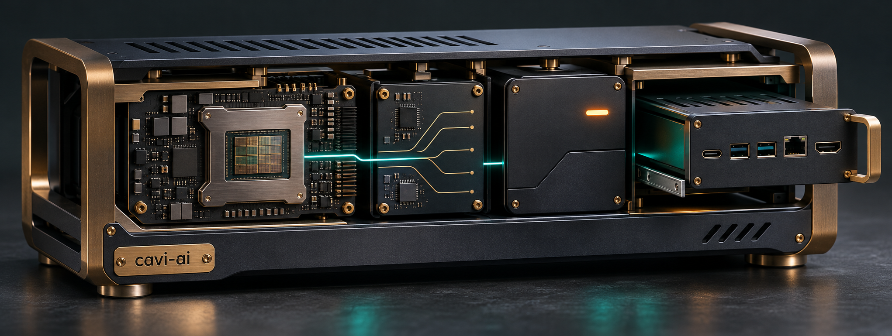

<h1 align="center">Build and run your own AI stack.</h1>

Open-source agent infrastructure, local inference, and application integrations.

  <a href="https://cavi-ai.xyz/docs"><strong>Docs</strong></a> ·
  <a href="https://huggingface.co/cavi-ai"><strong>Hugging Face</strong></a> ·
  <a href="https://github.com/cavi-ai/homebrew-tap"><strong>Homebrew</strong></a> ·
  <a href="https://github.com/cavi-ai?tab=repositories"><strong>Repositories</strong></a>

  

  
  

## Agent infrastructure

- **Run and coordinate workers.** Give specialists their own sessions and tools, queue handoffs, and bring results back to one main session. [Agent Sessions](https://github.com/cavi-ai/agent-sessions)
- **Build tools and connect runtimes.** Build typed Python MCP servers with [MCP Core](https://github.com/cavi-ai/mcp-core) and connect an app to multiple agent backends with [Cavi API Client](https://github.com/cavi-ai/cavi-api-client).
- **Run repeatable browser work.** Save workflows and resume from recorded progress in Firefox and Chromium. [Bobby Browser](https://github.com/cavi-ai/bobby-browser)
- **Protect access and verify fixes.** Set guards for credentials and local models with [Secure Agent](https://github.com/cavi-ai/secure-agent). Find recurring tool failures and verify fixes with [MCP Eval](https://github.com/cavi-ai/mcp-eval).

## Local inference

Compare models and runtimes on your Mac and share a protected endpoint over Tailscale with [MLX Workbench](https://github.com/cavi-ai/mlx-workbench). Run local models through the CLI or MCP with [MLX Agent](https://github.com/cavi-ai/mlx-agent).

## Application integrations

Keep research in [Obsidian](https://github.com/cavi-ai/companion-for-claude), build editable scenes in [Blender](https://github.com/cavi-ai/blender-mcp), revise dialogue in [Character Animator](https://github.com/cavi-ai/character-animator-mcp), or shape a track in [Ableton Live](https://github.com/cavi-ai/ableton-mcp).

## Full catalog

Projects and install guides

<!-- catalog:products exclude="" -->
### Creative apps

| Project | What it does | Install |
| :-- | :-- | :-- |
| [**Substance MCP**](https://github.com/cavi-ai/substance-mcp) | Local-first MCP servers for Adobe Substance 3D Painter, Designer and Sampler, with SHA-256 receipts across all three. | `uv tool install cavi-substance-mcp` · [Install guide](https://cavi-ai.xyz/products/substance-mcp/) |
| [**Blender MCP**](https://github.com/cavi-ai/blender-mcp) | Local-first MCP tools for Blender scene inspection, mesh editing, previews and game asset export. | `uv tool install cavi-blender-mcp` · [Install guide](https://cavi-ai.xyz/products/blender-mcp/) |
| [**Premiere MCP**](https://github.com/cavi-ai/premiere-mcp) | 42 typed tools for Premiere Pro on macOS that cut a clip list into a ProRes 422 HQ master. | `uv tool install cavi-premiere-mcp` · [Install guide](https://cavi-ai.xyz/products/premiere-mcp/) |
| [**After Effects MCP**](https://github.com/cavi-ai/after-effects-mcp) | 45 tools for headless After Effects on macOS, with aerender renders checked frame by frame. | `uv tool install cavi-after-effects-mcp` · [Install guide](https://cavi-ai.xyz/products/after-effects-mcp/) |
| [**Godot MCP**](https://github.com/cavi-ai/godot-mcp) | Inspect GLB models in Godot, review materials and animation poses, and explore assets in an interactive 3D viewer. | `uv tool install cavi-godot-mcp` · [Install guide](https://cavi-ai.xyz/products/godot-mcp/) |
| [**Ableton MCP**](https://github.com/cavi-ai/ableton-mcp) | Local-first Ableton Live control for MCP clients, with every change to the Set planned first and confirmed once. | `npm install -g @cavi-ai/ableton-mcp` · [Install guide](https://cavi-ai.xyz/products/ableton-mcp/) |
| [**Adobe MCP**](https://github.com/cavi-ai/adobe-mcp) | MCP tools for Photoshop, Illustrator, Animate, Character Animator and Dimension on macOS. | `uv tool install cavi-adobe-mcp` · [Install guide](https://cavi-ai.xyz/products/adobe-mcp/) |
| [**Character Animator MCP**](https://github.com/cavi-ai/character-animator-mcp) | Local-first MCP server for Adobe Character Animator, with prepared project copies and verified exports. | `uv tool install cavi-character-animator-mcp` · [Install guide](https://cavi-ai.xyz/products/character-animator-mcp/) |

### Browser automation

| Project | What it does | Install |
| :-- | :-- | :-- |
| [**Bobby Browser**](https://github.com/cavi-ai/bobby-browser) | Alpha. Capability-scoped browser automation across SDK, MCP, and authenticated CDP surfaces. | `brew install cavi-ai/tap/bobby-browser` · [Install guide](https://cavi-ai.xyz/products/bobby-browser/) |

### Obsidian

| Project | What it does | Install |
| :-- | :-- | :-- |
| [**Companion for Claude**](https://github.com/cavi-ai/claude-obsidian) | In-vault companion experience for Obsidian-powered knowledge and agent continuity. | [Install guide](https://cavi-ai.xyz/products/companion-for-claude/) |
| [**Obsidian Agent**](https://github.com/cavi-ai/obsidian-agent) | Portable, CLI-powered Obsidian workflows packaged for Claude, Codex, Gemini, OpenCode, and AgentSkills. | `/plugin marketplace add cavi-ai/obsidian-agent` · [Install guide](https://cavi-ai.xyz/products/obsidian-agent/) |

### Local models

| Project | What it does | Install |
| :-- | :-- | :-- |
| [**MLX Workbench**](https://github.com/cavi-ai/mlx-workbench) | Native macOS app for converting, verifying, serving and comparing local MLX models. | [Install guide](https://cavi-ai.xyz/products/mlx-workbench/) |
| [**MLX Agent**](https://github.com/cavi-ai/mlx-agent) | Discover, adopt, and safely wire local MLX models on Apple Silicon. | [Install guide](https://cavi-ai.xyz/products/mlx-agent/) |

### Secure and evaluate

| Project | What it does | Install |
| :-- | :-- | :-- |
| [**Secure Agent**](https://github.com/cavi-ai/secure-agent) | Local agent session monitoring and optional guards for file access and secret leaks. | [Install guide](https://cavi-ai.xyz/products/secure-agent/) |
| [**MCP Eval**](https://github.com/cavi-ai/mcp-eval) | Measure the operational cost MCP servers impose on agents and turn repeated friction into queryable findings. | `brew install cavi-ai/tap/mcpeval` · [Install guide](https://cavi-ai.xyz/products/mcp-eval/) |

### Build integrations

| Project | What it does | Install |
| :-- | :-- | :-- |
| [**API Client**](https://github.com/cavi-ai/cavi-api-client) | Typed HTTP, WebSocket, and SSE surfaces for compatible agent runtimes, with versioned reference documentation. | `npm install @cavi-ai/api-client` · [Install guide](https://cavi-ai.xyz/products/api-client/) |
| [**MCP Core**](https://github.com/cavi-ai/mcp-core) | Build Python MCP servers with typed results, compact schemas and structured failures. | `uv add cavi-mcp-core` · [Install guide](https://cavi-ai.xyz/products/mcp-core/) |
| [**Agent Sessions**](https://github.com/cavi-ai/agent-sessions) | Specialized workers, queued handoffs and leaner startup context for complex agent workflows. | `uv tool install git+https://github.com/cavi-ai/agent-sessions.git` · [Install guide](https://cavi-ai.xyz/products/agent-sessions/) |

### Host plugins

| Project | What it does | Install |
| :-- | :-- | :-- |
| [**CAVI Plugins**](https://github.com/cavi-ai/plugins) | Preview. One installation catalog for CAVI agent plugins and skills, per host. | `claude plugin marketplace add cavi-ai/plugins` · [Install guide](https://cavi-ai.xyz/products/plugins/) |
| [**Antigravity**](https://github.com/cavi-ai/openclaw-antigravity) | Connect OpenClaw to Google's Antigravity CLI (agy) as a subscription-backed model provider. | `openclaw plugins install @cavi-ai/antigravity` · [Install guide](https://cavi-ai.xyz/products/antigravity/) |
| [**Loop Killer**](https://github.com/cavi-ai/loop-killer) | Claude Code plugin that ends stop-hook re-prompt loops by clearing the active goal. | `/plugin install loop-killer@cavi-ai` · [Install guide](https://cavi-ai.xyz/products/loop-killer/) |
<!-- /catalog:products -->

Models on Hugging Face

<!-- catalog:models -->
| Model | What it does | Download |
| :-- | :-- | :-- |
| [`cavi-ai/Qwen3-VL-8B-Instruct-MLX-4bit`](https://huggingface.co/cavi-ai/Qwen3-VL-8B-Instruct-MLX-4bit) | Vision-language. MLX 4-bit. GUI grounding · English. Base model [`Qwen/Qwen3-VL-8B-Instruct`](https://huggingface.co/Qwen/Qwen3-VL-8B-Instruct). | `hf download cavi-ai/Qwen3-VL-8B-Instruct-MLX-4bit` |
| [`cavi-ai/bobby-control-detector`](https://huggingface.co/cavi-ai/bobby-control-detector) | Object detection. safetensors + ONNX. Base model [`PekingU/rtdetr_v2_r18vd`](https://huggingface.co/PekingU/rtdetr_v2_r18vd). | `hf download cavi-ai/bobby-control-detector` |
| [`cavi-ai/Audio8-ASR-Infinite-MLX-8bit`](https://huggingface.co/cavi-ai/Audio8-ASR-Infinite-MLX-8bit) | Speech recognition. MLX 8-bit. Streaming · English, Mandarin. Base model [`Edge0/Audio8-ASR-Infinite`](https://huggingface.co/Edge0/Audio8-ASR-Infinite). | `hf download cavi-ai/Audio8-ASR-Infinite-MLX-8bit` |
| [`cavi-ai/Audio8-ASR-Infinite-MLX-4bit`](https://huggingface.co/cavi-ai/Audio8-ASR-Infinite-MLX-4bit) | Speech recognition. MLX 4-bit. Streaming · English, Mandarin. Base model [`Edge0/Audio8-ASR-Infinite`](https://huggingface.co/Edge0/Audio8-ASR-Infinite). | `hf download cavi-ai/Audio8-ASR-Infinite-MLX-4bit` |
| [`cavi-ai/laya-MLX-8bit`](https://huggingface.co/cavi-ai/laya-MLX-8bit) | Text classification. MLX 8-bit. Routing, moderation · English, multilingual. Base model [`convaiinnovations/laya`](https://huggingface.co/convaiinnovations/laya). | `hf download cavi-ai/laya-MLX-8bit` |
<!-- /catalog:models -->

[Website](https://cavi-ai.xyz) · [Plugin catalog](https://github.com/cavi-ai/plugins)
