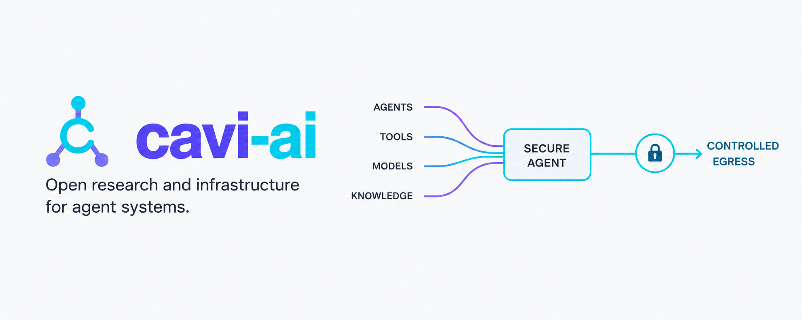

<picture>
  <source media="(prefers-color-scheme: dark)" srcset="./banner-dark.png">
  <source media="(prefers-color-scheme: light)" srcset="./banner-light.png">
  
</picture>

<h2 align="center">Open research and infrastructure for agent systems.</h2>

<p align="center">MIT-licensed MCP servers, Claude and Obsidian plugins, browser automation, and local MLX models: tools that make agent runtimes easier to connect, inspect, secure, and trust.</p>

<p align="center">
  <a href="https://obsidian.md/plugins?id=claude-companion"></a>
  <a href="https://github.com/cavi-ai/homebrew-tap"></a>
  <a href="https://cavi-ai.xyz/docs"></a>
  <a href="https://huggingface.co/cavi-ai"></a>
</p>

<p align="center">
  <a href="https://github.com/cavi-ai/companion-for-claude"><strong>Companion for Claude</strong></a>
  &nbsp;·&nbsp;
  <a href="https://github.com/cavi-ai/bobby-browser"><strong>Bobby Browser</strong></a>
  &nbsp;·&nbsp;
  <a href="https://github.com/cavi-ai/ableton-mcp"><strong>Ableton MCP</strong></a>
  &nbsp;·&nbsp;
  <a href="https://github.com/cavi-ai/cavi-api-client"><strong>CAVI API Client</strong></a>
  &nbsp;·&nbsp;
  <a href="#control-creative-apps-over-mcp"><strong>Creative apps</strong></a>
  &nbsp;·&nbsp;
  <a href="#models-on-hugging-face"><strong>Models</strong></a>
  &nbsp;·&nbsp;
  <a href="https://cavi-ai.xyz/docs"><strong>Documentation</strong></a>
</p>

---

## Start here

### Companion for Claude

[**Companion for Claude**](https://github.com/cavi-ai/companion-for-claude) brings Claude into your Obsidian vault: vault-aware chat, an agent mode whose edits you review hunk by hunk, sandboxed HTML artifacts, and evidence-backed research. The Obsidian Community Store release for Claude knowledge workflows. Connect with Claude Code, your own Anthropic key, or a local model.

<a href="https://github.com/cavi-ai/companion-for-claude"></a>

[**Install from the Obsidian store**](https://obsidian.md/plugins?id=claude-companion) · [**View source**](https://github.com/cavi-ai/companion-for-claude)

### Bobby Browser

[**Bobby Browser**](https://github.com/cavi-ai/bobby-browser) is an alpha browser-automation runtime for agents on Firefox and Chromium. Every call is authenticated, capability-scoped, journaled with evidence, and recoverable after a crash, through MCP, ACP, CDP, and SDKs for TypeScript, Python, and Rust.

**First result:** fill a form you control, inspect failed-field evidence, then
submit separately and check its saved result.
[Try the controlled-form workflow](https://github.com/cavi-ai/bobby-browser#try-a-controlled-form)
or [watch the walkthrough](https://github.com/cavi-ai/bobby-browser/blob/main/assets/form-walkthrough.mp4).

```sh
brew install cavi-ai/tap/bobby-browser
```

[**Install options**](https://github.com/cavi-ai/bobby-browser#install) · [**Documentation**](https://cavi-ai.xyz/docs/bobby-browser) · [**View source**](https://github.com/cavi-ai/bobby-browser)

---

## Explore the stack

Open building blocks for secure, local, and inspectable agent systems.

<table>
  <tr>
    <td width="50%"><a href="https://github.com/cavi-ai/secure-agent"></a></td>
    <td width="50%"><a href="https://github.com/cavi-ai/mlx-workbench"></a></td>
  </tr>
  <tr>
    <td align="center"><sub>Secure Agent</sub></td>
    <td align="center"><sub>MLX Workbench</sub></td>
  </tr>
</table>

### Control creative apps over MCP

| Project | What it does | Install |
| :-- | :-- | :-- |
| [**Ableton MCP**](https://github.com/cavi-ai/ableton-mcp) | Local-first control of Ableton Live for MCP clients through a Remote Script bridge, a stdio MCP server, and a CLI with confirm-to-execute mutations: every change to the Live Set is planned first and runs only with a single-use confirmation. | `npm install -g @cavi-ai/ableton-mcp`, then `ableton-mcp install` |
| [**Blender MCP**](https://github.com/cavi-ai/blender-mcp) | Local-first MCP tools for Blender scene inspection, mesh editing, previews, and game asset export, through a bridge that binds to loopback and requires a session token. | `uv tool install cavi-blender-mcp`, then `cavi-blender-mcp runtime start` to open Blender with the bridge |
| [**Substance MCP**](https://github.com/cavi-ai/substance-mcp) | Local-first MCP servers for Adobe Substance 3D Painter, Designer and Sampler: layer editing, baking, texture export, batch jobs that export for Unreal, Unity and Blender, and SHA-256 receipts that chain across all three apps. | `uv tool install cavi-substance-mcp` |
| [**Adobe MCP**](https://github.com/cavi-ai/adobe-mcp) | Local MCP servers for Adobe Photoshop, Illustrator, After Effects, Animate, Character Animator and Dimension on macOS. Each edits owned copies of documents inside one workspace and records every native operation before it runs. | `uv tool install cavi-adobe-mcp` |
| [**Premiere MCP**](https://github.com/cavi-ai/premiere-mcp) | Preview. MCP server for Adobe Premiere Pro on macOS: 42 typed tools run ExtendScript in Premiere Pro through an Adobe Bridge relay, and cut a clip list into a new project with transitions and a ProRes 422 HQ master. | `uv tool install git+https://github.com/cavi-ai/premiere-mcp.git` (Python 3.15+) |
| [**After Effects MCP**](https://github.com/cavi-ai/after-effects-mcp) | Preview. MCP server for headless After Effects on macOS: 45 tools for comps, layers, shapes, masks, text, keyframes, effects, 3D and Essential Graphics, with `aerender` renders that check every output movie's frame count. | `uv tool install git+https://github.com/cavi-ai/after-effects-mcp.git` (Python 3.15+) |

**Try one material choice:** [recreate a Painter roughness revision](https://github.com/cavi-ai/substance-mcp/blob/main/examples/painter/uniform-fill-revision/README.md)
with the original mesh and maps, or [trace a two-material FBX into Painter](https://github.com/cavi-ai/blender-mcp/blob/main/examples/material-texture-sets/README.md).

### Secure and evaluate agents

| Project | What it does | Install |
| :-- | :-- | :-- |
| [**Secure Agent**](https://github.com/cavi-ai/secure-agent) | Local monitor for AI coding agents on macOS: sessions, processes, file activity, and network destinations. Optional guards can stop supported tool calls; an opt-in proxy inspects routed traffic for secret leaks. | Download the [macOS app](https://github.com/cavi-ai/secure-agent/releases/latest) (macOS 14 or later) |
| [**MCP Eval**](https://github.com/cavi-ai/mcp-eval) | Evidence-driven MCP-server evaluation across discovery cost, schema guessability, error honesty, state recovery, and contention — turning agent friction into actionable findings. | `brew install cavi-ai/tap/mcpeval` |

### Build agent integrations

| Project | What it does | Install |
| :-- | :-- | :-- |
| [**CAVI API Client**](https://github.com/cavi-ai/cavi-api-client) | One TypeScript client for many agent runtimes: adapts Claude, Codex, AGY, OpenCode, Hermes, and OpenClaw to shared contracts for runs, statuses, stream events, and token usage, so you write one progress renderer and one failure handler. Gateway-agnostic agent runtime infrastructure over typed HTTP, WebSocket, and SSE; ESM with no runtime dependencies. | `npm install @cavi-ai/api-client` |
| [**MCP Core**](https://github.com/cavi-ai/mcp-core) | Shared Python core for MCP servers: one server type, one structured failure contract, compact tool schemas, bounded process runs and file reads, and an operation journal. Adobe MCP is built on it. | `uv add cavi-mcp-core` |
| [**Agent Sessions**](https://github.com/cavi-ai/agent-sessions) | Find the Codex and Claude Code sessions that share a repository, send work to a peer, and claim messages before acting on them. Discovery and messaging run locally and never interrupt a running session. | `uv tool install git+https://github.com/cavi-ai/agent-sessions.git` (macOS or Linux) |

### Run local models on Apple Silicon

| Project | What it does | Install |
| :-- | :-- | :-- |
| [**MLX Agent**](https://github.com/cavi-ai/mlx-agent) | Discovers, verifies, and wires local MLX-optimized models on Apple Silicon — Claude, Codex, Antigravity, OpenCode, and AgentSkills. | `claude plugin marketplace add cavi-ai/mlx-agent`, then `claude plugin install mlx-agent@mlx-agent` |
| [**MLX Workbench**](https://github.com/cavi-ai/mlx-workbench) | Native macOS app for the MLX Agent model lifecycle: converts, verifies, compares, serves, and fine-tunes local models on Apple Silicon. | Download the [macOS app](https://github.com/cavi-ai/mlx-workbench/releases/latest) (Apple Silicon) |

### Plugins for agent hosts

| Project | What it does | Install |
| :-- | :-- | :-- |
| [**CAVI Plugins**](https://github.com/cavi-ai/plugins) | Host-neutral plugin catalog across Claude, Codex, Agy, OpenCode, OpenClaw, Hermes, and AgentSkills. | `claude plugin marketplace add cavi-ai/plugins` |
| [**Obsidian Agent**](https://github.com/cavi-ai/obsidian-agent) | Portable, CLI-powered Obsidian workflows across agent hosts. | `/plugin marketplace add cavi-ai/obsidian-agent`, then `/plugin install obsidian-agent@obsidian-agent` in Claude Code |
| [**Antigravity for OpenClaw**](https://github.com/cavi-ai/openclaw-antigravity) | OpenClaw provider plugin for Google's Antigravity CLI. | `openclaw plugins install @cavi-ai/antigravity` |
| [**Loop Killer**](https://github.com/cavi-ai/loop-killer) | Claude Code plugin that ends stop-hook re-prompt loops: when replies to a re-prompting hook stop doing tool work, it clears the active goal and says so. | `claude plugin marketplace add cavi-ai/plugins`, then `/plugin install loop-killer@cavi-ai` in Claude Code |

## Models on Hugging Face

MLX conversions for Apple Silicon and a page-control detector, published at [huggingface.co/cavi-ai](https://huggingface.co/cavi-ai). Each model card names its base model, the exact source revision, its contents and its requirements.

| Model | What it does | Download |
| :-- | :-- | :-- |
| [`cavi-ai/Qwen3-VL-8B-Instruct-MLX-4bit`](https://huggingface.co/cavi-ai/Qwen3-VL-8B-Instruct-MLX-4bit) | Image and text to text. 4-bit MLX conversion of Qwen3-VL-8B-Instruct; the vision tower stays in bf16. | `hf download cavi-ai/Qwen3-VL-8B-Instruct-MLX-4bit` |
| [`cavi-ai/Audio8-ASR-Infinite-MLX-8bit`](https://huggingface.co/cavi-ai/Audio8-ASR-Infinite-MLX-8bit) | Speech recognition. 8-bit MLX conversion of Audio8-ASR-Infinite; the audio tower stays in bf16. | `hf download cavi-ai/Audio8-ASR-Infinite-MLX-8bit` |
| [`cavi-ai/Audio8-ASR-Infinite-MLX-4bit`](https://huggingface.co/cavi-ai/Audio8-ASR-Infinite-MLX-4bit) | Speech recognition. 4-bit MLX conversion of Audio8-ASR-Infinite. | `hf download cavi-ai/Audio8-ASR-Infinite-MLX-4bit` |
| [`cavi-ai/laya-MLX-8bit`](https://huggingface.co/cavi-ai/laya-MLX-8bit) | Text classification. MLX conversion of laya with its English, multilingual and typed-decisions checkpoints. | `hf download cavi-ai/laya-MLX-8bit` |
| [`cavi-ai/bobby-control-detector`](https://huggingface.co/cavi-ai/bobby-control-detector) | Object detection. Finds the interactable controls in a web page screenshot; fine-tuned from RT-DETRv2, shipped as safetensors and ONNX. | `hf download cavi-ai/bobby-control-detector` |

## Built in the open

Every public CAVI-AI project ships with its source. Read the code, test the assumptions, adapt the tools, and contribute what you learn. More work is in development — we publish it when there is working software and evidence worth examining.

<p align="center">
  <a href="https://cavi-ai.xyz">cavi-ai.xyz</a>
  &nbsp;·&nbsp;
  <a href="https://github.com/cavi-ai?tab=repositories">all repositories</a>
  &nbsp;·&nbsp;
  <a href="https://github.com/cavi-ai/plugins">plugin catalog</a>
  &nbsp;·&nbsp;
  <a href="https://huggingface.co/cavi-ai">models</a>
</p>

<p align="center"><sub>MIT licensed · Source published</sub></p>
