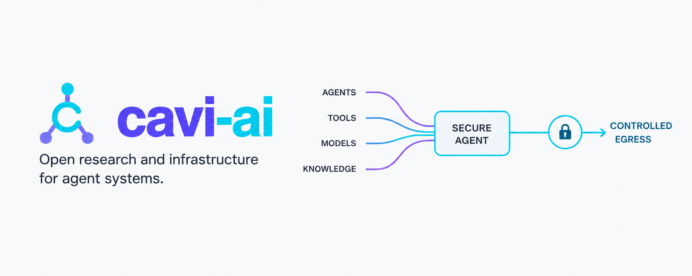

<picture>
  <source media="(prefers-color-scheme: dark)" srcset="./banner-dark.png">
  <source media="(prefers-color-scheme: light)" srcset="./banner-light.png">
  
</picture>

<h2 align="center">Open research and infrastructure for agent systems.</h2>

MIT-licensed tools that make agent runtimes easier to connect, inspect, secure, and trust.

  <a href="https://github.com/cavi-ai/companion-for-claude"><strong>Companion for Claude</strong></a>
  &nbsp;·&nbsp;
  <a href="https://github.com/cavi-ai/bobby-browser"><strong>Bobby Browser</strong></a>
  &nbsp;·&nbsp;
  <a href="https://github.com/cavi-ai/ableton-mcp"><strong>Ableton MCP</strong></a>
  &nbsp;·&nbsp;
  <a href="https://cavi-ai.xyz/docs"><strong>Documentation</strong></a>

---

## Start here

### Companion for Claude

[**Companion for Claude**](https://github.com/cavi-ai/companion-for-claude) brings Claude into your Obsidian vault: vault-aware chat, an agent mode whose edits you review hunk by hunk, sandboxed HTML artifacts, and evidence-backed research. The Obsidian Community Store release for Claude knowledge workflows. Connect with Claude Code, your own Anthropic key, or a local model.

[**Install from the Obsidian store**](https://obsidian.md/plugins?id=claude-companion) · [**View source**](https://github.com/cavi-ai/companion-for-claude)

### Bobby Browser

[**Bobby Browser**](https://github.com/cavi-ai/bobby-browser) is an alpha browser-automation runtime for agents on Firefox and Chromium. Every call is authenticated, capability-scoped, journaled with evidence, and recoverable after a crash, through MCP, ACP, CDP, and SDKs for TypeScript, Python, and Rust.

[**Install**](https://github.com/cavi-ai/bobby-browser#install) · [**Documentation**](https://cavi-ai.xyz/docs/bobby-browser) · [**View source**](https://github.com/cavi-ai/bobby-browser)

### Ableton MCP

[**Ableton MCP**](https://github.com/cavi-ai/ableton-mcp) gives MCP clients local-first control of Ableton Live through a Remote Script bridge, a stdio MCP server, and a CLI with confirm-to-execute mutations: every change to the Live Set is planned first and runs only with a single-use confirmation.

[**Install**](https://github.com/cavi-ai/ableton-mcp#install) · [**View source**](https://github.com/cavi-ai/ableton-mcp)

---

## Install

| Product | Install |
| :-- | :-- |
| Companion for Claude | In Obsidian: **Settings → Community plugins → Browse**, search "Companion for Claude", or open the [store listing](https://obsidian.md/plugins?id=claude-companion). |
| Bobby Browser | `brew install cavi-ai/tap/bobby-browser` |
| Ableton MCP | [Clone and install](https://github.com/cavi-ai/ableton-mcp#install) on macOS with Ableton Live and Node.js. |
| MCP Eval | `brew install cavi-ai/tap/mcpeval` |
| CAVI API Client | `npm install @cavi-ai/api-client` |

---

## Explore the stack

Open building blocks for secure, local, and inspectable agent systems.

### Secure and evaluate agents

| Project | What it does |
| :-- | :-- |
| [**Secure Agent**](https://github.com/cavi-ai/secure-agent) | Local monitor for AI coding agents on macOS: sessions, processes, file activity, and network destinations. Optional guards can stop supported tool calls; an opt-in proxy inspects routed traffic for secret leaks. |
| [**MCP Eval**](https://github.com/cavi-ai/mcp-eval) | Evidence-driven MCP-server evaluation across discovery cost, schema guessability, error honesty, state recovery, and contention — turning agent friction into actionable findings. |

### Run local models on Apple Silicon

| Project | What it does |
| :-- | :-- |
| [**MLX Agent**](https://github.com/cavi-ai/mlx-agent) | Discovers, verifies, and wires local MLX-optimized models on Apple Silicon — Claude, Codex, Antigravity, OpenCode, and AgentSkills. |
| [**MLX Workbench**](https://github.com/cavi-ai/mlx-workbench) | Native macOS app for the MLX Agent model lifecycle: converts, verifies, compares, serves, and fine-tunes local models on Apple Silicon. |

### Connect and extend agent hosts

| Project | What it does |
| :-- | :-- |
| [**CAVI API Client**](https://github.com/cavi-ai/cavi-api-client) | Gateway-agnostic TypeScript client — agent runtime infrastructure for typed HTTP, WebSocket, and SSE. |
| [**CAVI Plugins**](https://github.com/cavi-ai/plugins) | Host-neutral plugin catalog across Claude, Codex, Gemini, OpenCode, and AgentSkills. |
| [**Obsidian Agent**](https://github.com/cavi-ai/obsidian-agent) | Portable, CLI-powered Obsidian workflows across agent hosts. |
| [**Antigravity for OpenClaw**](https://github.com/cavi-ai/openclaw-antigravity) | OpenClaw provider plugin for Google's Antigravity CLI. |

## Research and verification

- **Agent security** — recording what local agents read, run, and connect to, with guards you opt into.
- **Runtime interoperability** — connecting gateways and providers through typed boundaries.
- **Local-first workflows** — running models and knowledge tools on hardware you control.
- **MCP reliability** — measuring discovery cost, schema guessability, error honesty, state recovery, and contention.

## Built in the open

Every public CAVI-AI project ships with its source and provenance. Read the code, test the assumptions, adapt the tools, and contribute what you learn. More work is in development — we publish it when there is working software and evidence worth examining.

  <a href="https://cavi-ai.xyz">cavi-ai.xyz</a>
  &nbsp;·&nbsp;
  <a href="https://github.com/cavi-ai?tab=repositories">all repositories</a>
  &nbsp;·&nbsp;
  <a href="https://github.com/cavi-ai/plugins">plugin catalog</a>

MIT licensed · Source published · Provenance attached

